  <picture>
    <source media="(prefers-color-scheme: dark)" srcset="assets/raven-icon-dark.svg">
    
  </picture>

<h1 align="center">Raven</h1>

<b>Your private AI workspace, by ZEDEDA.</b> Chat, files, a browser and tools in one window, on your own computer. Raven is in beta.

  
  
  

<!-- RAVEN_BUTTONS -->

  
  
  

<!-- /RAVEN_BUTTONS -->

This repository holds Raven's releases. It contains no source code.

<!-- RAVEN_DOWNLOADS -->
## Download Raven 0.1.2

| System | Processor | Download |
|---|---|---|
| macOS 13 or later | Apple Silicon | [Raven-0.1.2.dmg](https://github.com/zededa/raven-releases/releases/download/v0.1.2/Raven-0.1.2-mac-arm64.dmg) |
| Windows 11 | x64 (Intel, AMD) | [Install](https://github.com/zededa/raven-releases/releases/download/v0.1.2/Raven-x64.appinstaller) · [MSIX package](https://github.com/zededa/raven-releases/releases/download/v0.1.2/Raven-0.1.2-win-x64.msix) |
| Windows 11 | ARM64 | [Install](https://github.com/zededa/raven-releases/releases/download/v0.1.2/Raven-arm64.appinstaller) · [MSIX package](https://github.com/zededa/raven-releases/releases/download/v0.1.2/Raven-0.1.2-win-arm64.msix) |
| Linux | x64 | [AppImage](https://github.com/zededa/raven-releases/releases/download/v0.1.2/Raven-0.1.2-linux-x86_64.AppImage) |
| Linux | ARM64 | [AppImage](https://github.com/zededa/raven-releases/releases/download/v0.1.2/Raven-0.1.2-linux-arm64.AppImage) |

Older versions and the release notes are on the [releases page](https://github.com/zededa/raven-releases/releases).
<!-- /RAVEN_DOWNLOADS -->

## Install

- **macOS 13 or later, on Apple Silicon:** open the DMG and drag Raven to Applications.
- **Windows 11:** open the "Install" file (`.appinstaller`). Windows installs Raven and keeps it up to date. The MSIX package installs the same app without automatic updates.
- **Linux:** make the AppImage executable (`chmod +x Raven-*.AppImage`) and run it from a folder you can write to.

To sign in you need an account on a ZEDEDA Raven Console.

## Verify your download

- **macOS:** `spctl -a -vv /Applications/Raven.app` should say *accepted, source=Notarized Developer ID, origin=Developer ID Application: Zededa Germany GmbH*.
- **Windows (PowerShell):** `Get-AuthenticodeSignature .\Raven-*.msix` should say *Valid*, signed by *Zededa Germany GmbH*.
- **Any system:** compare `shasum -a 256 <file>` with the line for that file in `SHA256SUMS.txt`.

## Updates

On macOS and Linux, Raven keeps itself up to date: it downloads a new version in the background and installs it when you quit. Under Settings > About you can switch this off, and "Check for updates" is always there. On Windows, when Raven was installed from the "Install" file, Windows checks for a new version when Raven starts, at most every 12 hours.

## What changed

Each [release](https://github.com/zededa/raven-releases/releases) lists what is new, improved and fixed. Raven shows the same notes under Settings > About.

## Feedback and problems

In Raven, open the profile menu and choose "Send feedback".

To report a security problem, see [SECURITY.md](SECURITY.md).

## Licences

Raven includes open-source software. See [LICENSE-NOTICES.md](LICENSE-NOTICES.md).
